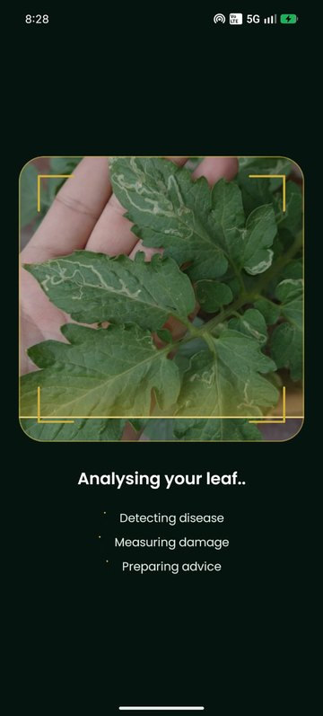
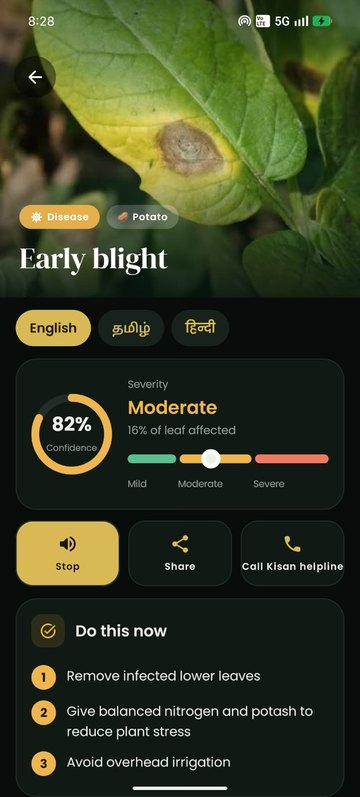
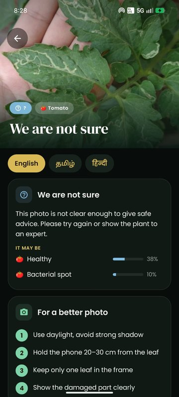
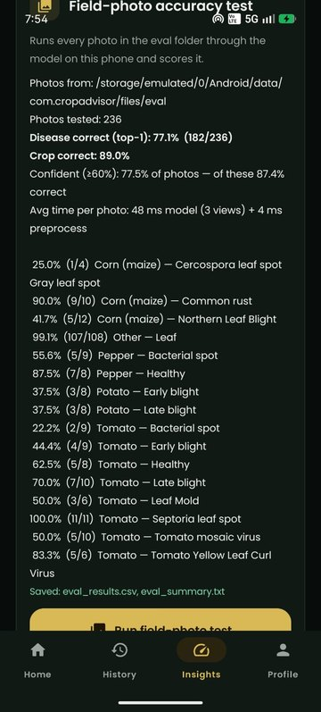
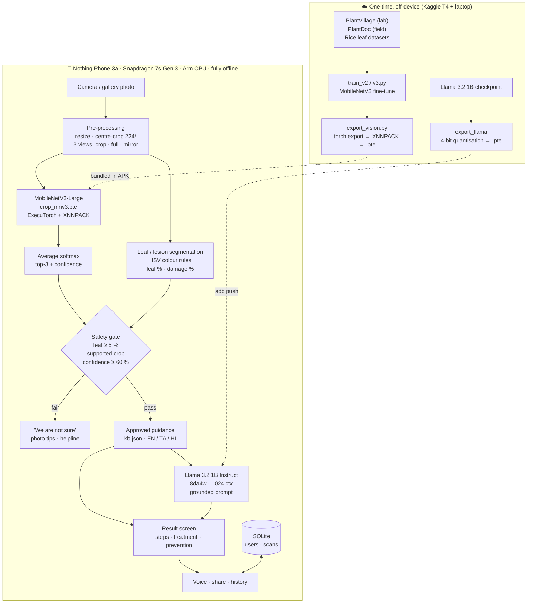

<div align="center">


# Uzhavan · உழவன்

**An offline AI crop doctor that runs entirely on an Arm smartphone**

Photograph a leaf → get the disease, how severe it is, and what to do — in English, Tamil or Hindi — with **no internet**.


*Bharat AI-SoC Student Challenge 2026–27 · Problem Statement 1*

</div>

---

## Why

Small farmers often notice a sick leaf weeks before an expert can visit, and many fields have weak or no mobile data.
Uzhavan (Tamil for *farmer*) puts a disease classifier **and** a small language model on the phone itself, so a diagnosis
and safe, approved advice are available in the field, in the farmer's language, in under a second.

## Screenshots

<div align="center">
&nbsp;
&nbsp;
&nbsp;

<br/><sub>Scanning · Diagnosis with severity · Safe "not sure" answer for an unknown pest · On-device accuracy test</sub>
</div>

## Features

| | |
|---|---|
| 🌿 **Disease detection** | 23 diseases / healthy states across tomato, potato, bell pepper, maize and rice, plus "other crop" |
| 📏 **Severity** | Percentage of the leaf affected → Mild / Moderate / Severe, with an urgent-help banner when severe |
| 🤖 **On-device AI advisor** | Llama 3.2 1B (4-bit) explains the approved treatment in simple steps, streamed word by word |
| 🛡️ **Safety first** | No leaf, an unsupported crop, or low confidence → no treatment advice, only "retake / ask an expert" |
| 🗣️ **3 languages + voice** | English, Tamil, Hindi UI and guidance; text-to-speech read-out; share report; Kisan helpline call |
| 👤 **Offline accounts** | Mobile number + password, security-question reset, per-user scan history in an on-device SQLite database |
| 📊 **Built-in benchmarks** | Model load times, latency over 30 runs, LLM tokens/s, and a full field-photo accuracy test — all on the phone |

## Architecture



**Design choices**

- **Two models, two jobs.** A 5 M-parameter CNN does the diagnosis (fast, measurable accuracy); the 1 B-parameter LLM only
  *explains* advice that already exists in a vetted knowledge base, so it cannot invent a chemical or a dose.
- **One shared runtime.** Both models run through ExecuTorch with the XNNPACK backend on the Arm CPU cores. Calls are
  serialised with a single lock because both share XNNPACK's thread-pool.
- **Test-time augmentation.** Each photo is classified three times (centre crop, whole frame, mirror) and the
  probabilities averaged — steadier on real, cluttered field photos at ~16 ms per run.
- **Fail safe, not confident.** Below 60 % confidence, or when the photo has too little leaf, the app refuses to diagnose.

## Results

Measured **on the phone**, through the app's own pipeline (*Insights → Run field-photo test*), on **236 real farm
photos** from the PlantDoc test split — never seen during training.

| Metric | Result |
|---|---|
| Disease correct — 5 supported crops | **58.6 %** (75 / 128) |
| Crop correct | **89.0 %** |
| Answered with confidence ≥ 60 % | 77.5 % of photos → **87.4 % correct** |
| "Other crop" leaves recognised | 99.1 % (107 / 108) |
| Lab photos (PlantVillage test split) | 98.9 % |
| Vision latency (3 views, Arm CPU) | **48 ms** + 4 ms pre-processing |
| Vision model load | 192 ms |
| Llama 3.2 1B load | ≈ 2.5 s |

The phone's field accuracy (58.6 %) matches the PyTorch result on Kaggle (59.4 %) to within one photo, so exporting to
ExecuTorch / XNNPACK costs no accuracy.

<details>
<summary><b>Per-class field accuracy</b></summary>

| Class | Correct |
|---|---|
| Tomato — Septoria leaf spot | 100 % (11/11) |
| Maize — Common rust | 90 % (9/10) |
| Pepper — Healthy | 87.5 % (7/8) |
| Tomato — Yellow leaf curl virus | 83.3 % (5/6) |
| Tomato — Late blight | 70 % (7/10) |
| Tomato — Healthy | 62.5 % (5/8) |
| Pepper — Bacterial spot | 55.6 % (5/9) |
| Tomato — Leaf mold | 50 % (3/6) |
| Tomato — Mosaic virus | 50 % (5/10) |
| Tomato — Early blight | 44.4 % (4/9) |
| Maize — Northern leaf blight | 41.7 % (5/12) |
| Potato — Early blight | 37.5 % (3/8) |
| Potato — Late blight | 37.5 % (3/8) |
| Maize — Grey leaf spot | 25 % (1/4) |
| Tomato — Bacterial spot | 22.2 % (2/9) |

Full per-photo results: [`docs/eval_results_v2.csv`](docs/eval_results_v2.csv) · summary: [`docs/eval_summary_v2.txt`](docs/eval_summary_v2.txt)
</details>

## Tech stack

| Layer | Technology |
|---|---|
| App | Kotlin, Jetpack Compose (Material 3), CameraX, Android TextToSpeech |
| On-device inference | PyTorch **ExecuTorch** 1.x, **XNNPACK** delegate (Arm NEON), LlmModule runner |
| Vision model | MobileNetV3-Large (ImageNet → PlantVillage + PlantDoc + rice), FP32 |
| Language model | Llama 3.2 1B Instruct, 8-bit dynamic activations / 4-bit weights, KV-cache + SDPA |
| Storage | SQLite (app-private), PBKDF2-HMAC-SHA256 salted passwords |
| Training | PyTorch + torchvision on Kaggle (NVIDIA T4), mixed precision |

## Repository structure

```
├── app/src/main/java/com/cropadvisor/
│   ├── Vision.kt          MobileNetV3 inference, 3-view TTA, leaf & lesion segmentation
│   ├── Advisor.kt         Llama 3.2 1B loading, grounded prompt, streaming generation
│   ├── AppState.kt        app logic: scans, advice, accounts, benchmarks, field test
│   ├── Db.kt              on-device SQLite database (users, scans) + password hashing
│   ├── Strings.kt         all UI text in English, Tamil, Hindi
│   └── ui/                Compose screens, theme, logo & animations
├── app/src/main/assets/   kb.json (approved guidance, 3 languages) · labels.json
├── training/
│   ├── train_v2.py        Kaggle training (lab + field photos)
│   ├── train_v3.py        + extra field datasets, longer schedule
│   ├── export_vision.py   PyTorch → ExecuTorch .pte (XNNPACK)
│   └── prepare_eval.py    copies the PlantDoc test photos to the phone for the on-device test
├── docs/                  results, screenshots, logo
└── uzhavan.sh             one command: export Llama, push models, build, install, launch
```

## Build & run

**Requirements:** Ubuntu laptop with Android SDK + JDK 17, an ExecuTorch source checkout (`~/executorch`) with its Python
env (`~/et-env`), the Llama 3.2 1B Instruct checkpoint, and an Arm64 Android phone with USB debugging on.

```bash
# 1. vision model: train on Kaggle (training/train_v3.py), download crop_mnv3_v3.pth + labels.json into ~/crop, then
source ~/et-env/bin/activate && cd ~/crop && python ~/CropAdvisor/training/export_vision.py

# 2. everything else — Llama export (first time), push to phone, build, install, open
bash ~/CropAdvisor/uzhavan.sh

# 3. optional: on-device accuracy test (then Insights → Run field-photo test)
python3 ~/CropAdvisor/training/prepare_eval.py
```

Model files (`*.pte`, `*.pth`, ~17 MB + ~0.8 GB) are not stored in git; the scripts above produce them.

## Safety & privacy

- Advice comes only from `kb.json`; Llama is instructed to use **only** that guidance and never add a chemical or dose.
- If Llama ever crashes, it is switched off automatically and the approved guidance is still shown.
- Everything — photos, history, accounts — stays on the phone. No network permission is used for inference.
- Passwords are salted and hashed (PBKDF2); 5 wrong attempts lock the account for 30 s.

## Limitations & next steps

- Real-field accuracy (~59 %) is far below lab accuracy (99 %): field photos have clutter, shadows and mixed symptoms,
  and public field datasets are small (4–12 test photos per class, so per-class numbers are rough).
- Pests such as leaf miner are outside the training classes — the app answers "not sure" rather than guessing.
- Severity is a colour heuristic, not a trained segmentation model.
- Next: more Indian field photos, INT8 vision model, NPU delegate (Qualcomm QNN) for lower power, Tamil LLM output.

## Acknowledgements

[PlantVillage](https://github.com/spMohanty/PlantVillage-Dataset) · [PlantDoc](https://github.com/pratikkayal/PlantDoc-Dataset) ·
[PyTorch ExecuTorch](https://github.com/pytorch/executorch) · [Meta Llama 3.2](https://www.llama.com/) ·
Poppins & DM Serif Display fonts (SIL OFL) · Kisan Call Centre 1800-180-1551

## License

Code: [MIT](LICENSE). Llama 3.2 is used under the Llama 3.2 Community License; datasets under their own licenses.
