<div align="center">

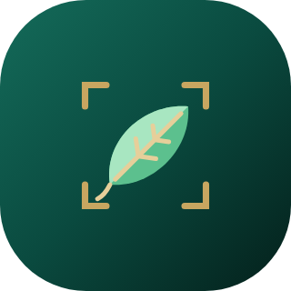

# Uzhavan · உழவன்

### The farmer's AI crop doctor — fully offline, on an Arm smartphone

Photograph one leaf → get the **disease**, **how severe it is** and **what to do now**,
in **English, தமிழ் or हिन्दी**, spoken aloud — with **no internet**.


-0467DF?logo=meta&logoColor=white)


*Bharat AI-SoC Student Challenge 2026–27 · Problem Statement 1 — offline crop disease & pest detection and advisory*

[Screenshots](#screenshots) · [How to use](#how-to-use) · [Architecture](#architecture) · [Results](#results) ·
[Build & run](#build--run) · [Safety](#safety--privacy)

<br/>

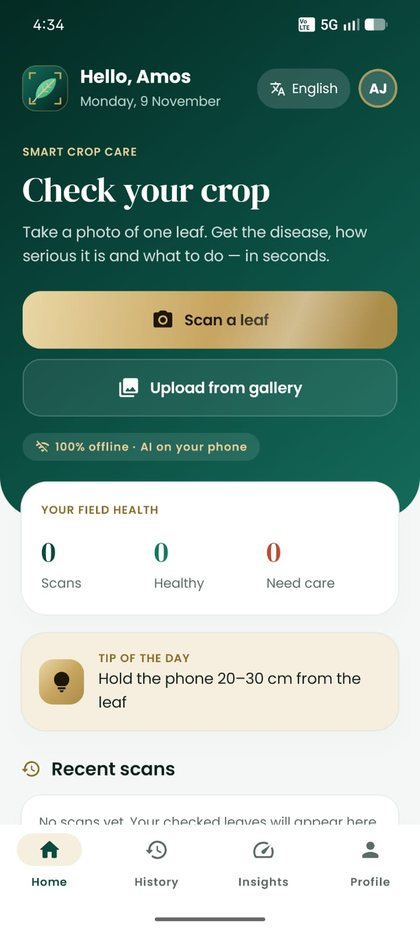&nbsp;
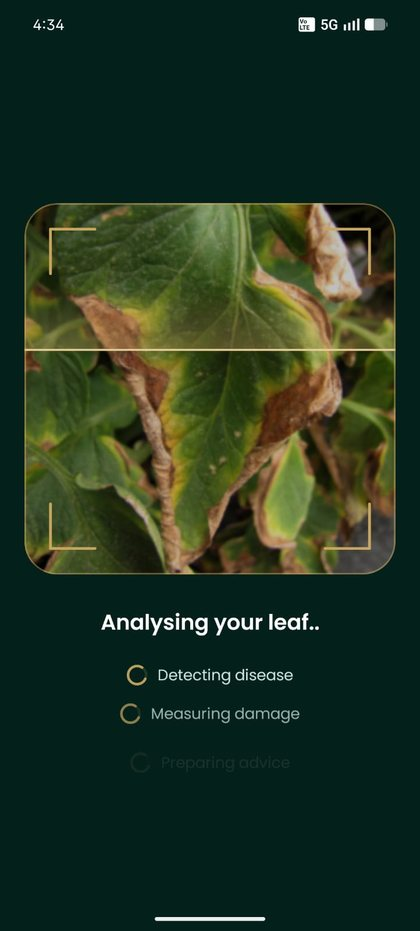&nbsp;
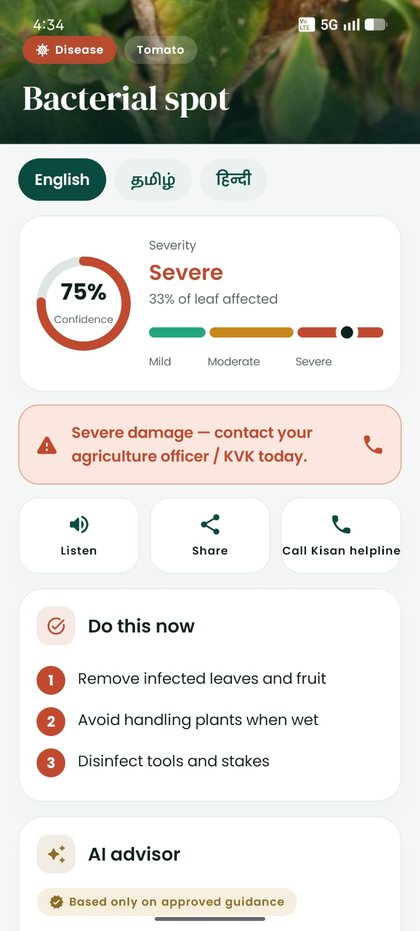&nbsp;
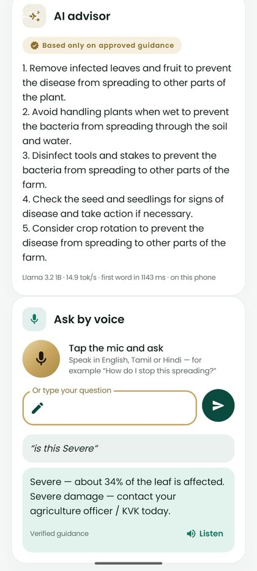

</div>

---

## Why Uzhavan

A small farmer usually notices a sick leaf long before an expert can visit — and many fields have weak or no mobile
data. Uzhavan (Tamil for *farmer*) runs a **disease-detection model and a 1-billion-parameter language model directly on
the phone's Arm CPU**, so a diagnosis and safe, approved advice are available in the field, in the farmer's own
language, by voice, within a second.

| ⚡ 29–41 ms | 🎯 93 % | 🧠 ~15 tok/s | 📴 100 % offline | 🗣️ 3 languages |
|:---:|:---:|:---:|:---:|:---:|
| per leaf photo, on the phone's Arm CPU | correct whenever the app is sure (real farm photos) | Llama 3.2 1B advice, first word in ~1 s | no INTERNET permission at all | English · Tamil · Hindi, text and speech |

## Features

| | |
|---|---|
| 🌿 **Disease & pest detection** | 23 classes across **tomato, potato, bell pepper, maize, rice** — diseases, pests (rice hispa, spider mites) and healthy leaves — plus "other crop" |
| 🎯 **Frame-guided camera** | The photo is cropped to the gold frame the farmer aimed at, so background never confuses the model |
| 📏 **Severity** | Share of the leaf affected → Mild / Moderate / Severe, with an urgent "contact your KVK today" banner when severe |
| 🤖 **On-device AI advisor** | Llama 3.2 1B (4-bit) explains the verified care plan in numbered steps, streamed word by word |
| 🎙️ **Ask by voice — or type** | Ask in English, Tamil or Hindi. Severity and treatment questions are answered exactly from the scan and the verified guidance; other questions by Llama, grounded in it. Every answer is read aloud |
| 🛡️ **Safety first** | No leaf, an unsupported crop, or low confidence → no treatment advice, only "retake / ask an expert" |
| 🔁 **Same disease, two crops** | Early blight on tomato and potato is the same fungus with the same care: the app merges both answers instead of saying "not sure" |
| 👤 **Farmer-friendly accounts** | Mobile number + password (a 4-digit PIN is fine), forgot password → confirm name and village; history in an on-device SQLite database |
| 📊 **Proof on the device** | Insights tab: model load times, latency benchmark, LLM tokens/s and a full field-photo accuracy test — all measured on the phone |
| 🌗 **Premium design** | Jade & champagne theme, light / dark mode, animated logo, smooth transitions, no emojis |

## Screenshots

<table>
<tr>
<td align="center">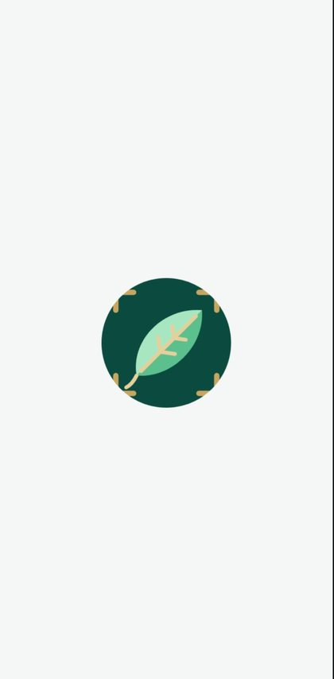<br/><sub>Launch</sub></td>
<td align="center">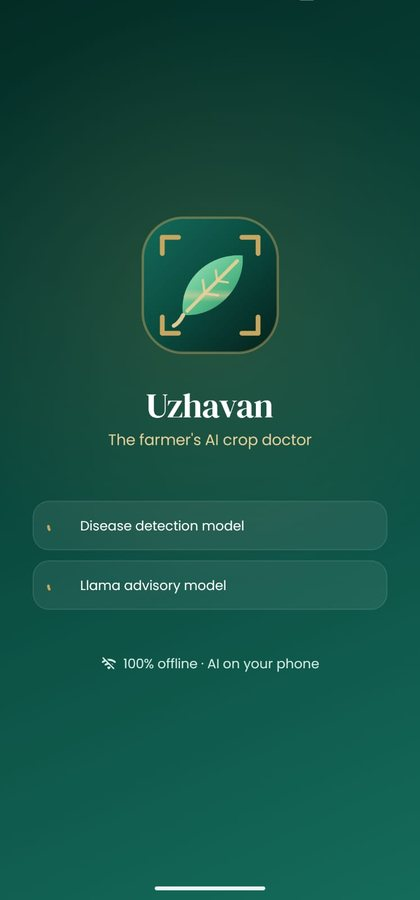<br/><sub>Both AI models load on-device</sub></td>
<td align="center">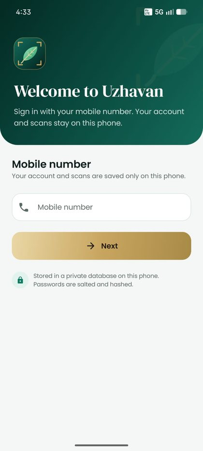<br/><sub>Sign in with mobile number</sub></td>
<td align="center">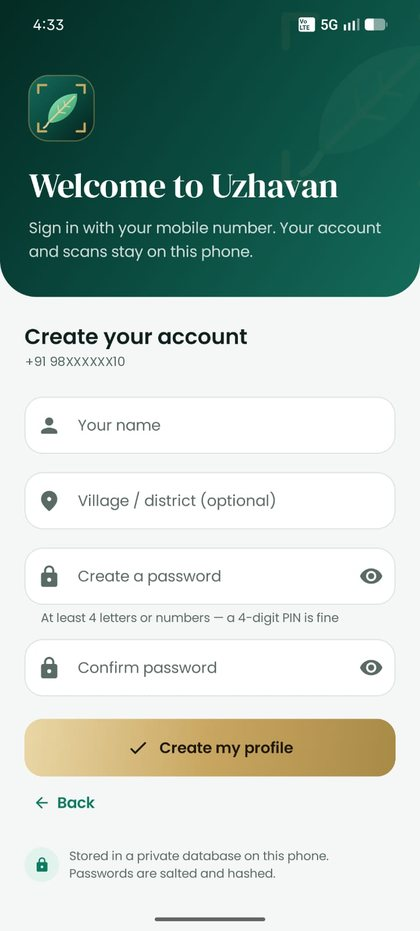<br/><sub>Simple sign-up for farmers</sub></td>
</tr>
<tr>
<td align="center"><br/><sub>Home</sub></td>
<td align="center"><br/><sub>Scanning the leaf</sub></td>
<td align="center"><br/><sub>Diagnosis · confidence · severity</sub></td>
<td align="center"><br/><sub>AI advisor · ask by voice</sub></td>
</tr>
<tr>
<td align="center">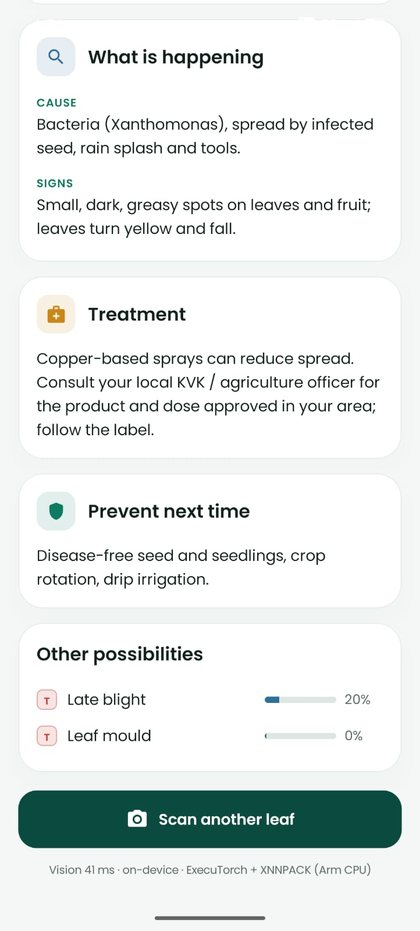<br/><sub>Cause · treatment · prevention</sub></td>
<td align="center">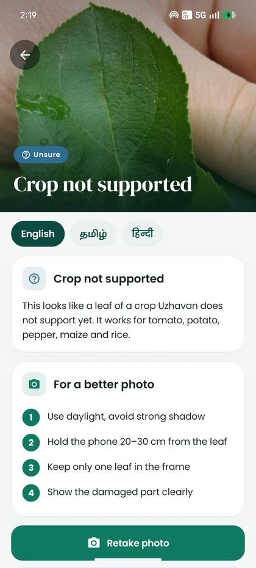<br/><sub>Safety: crop not supported</sub></td>
<td align="center">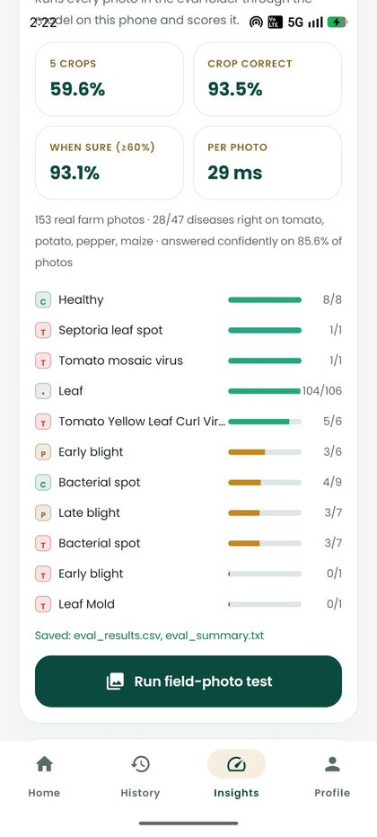<br/><sub>On-device accuracy test</sub></td>
<td align="center">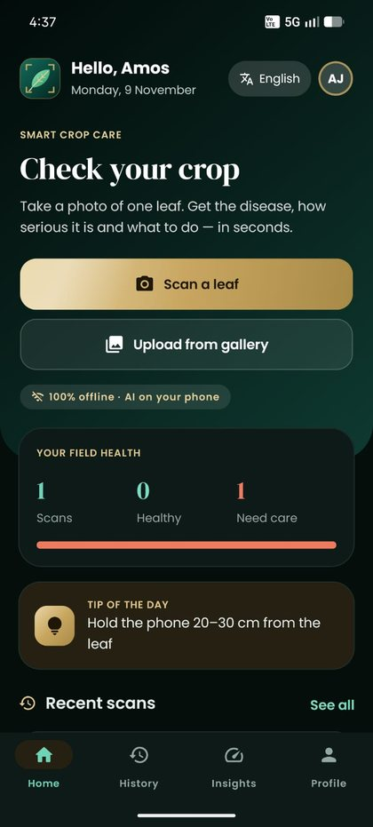<br/><sub>Dark mode</sub></td>
</tr>
</table>

<details>
<summary><b>Tamil & Hindi — the whole app, guidance and voice in the farmer's language</b></summary>
<br/>
<table>
<tr>
<td align="center">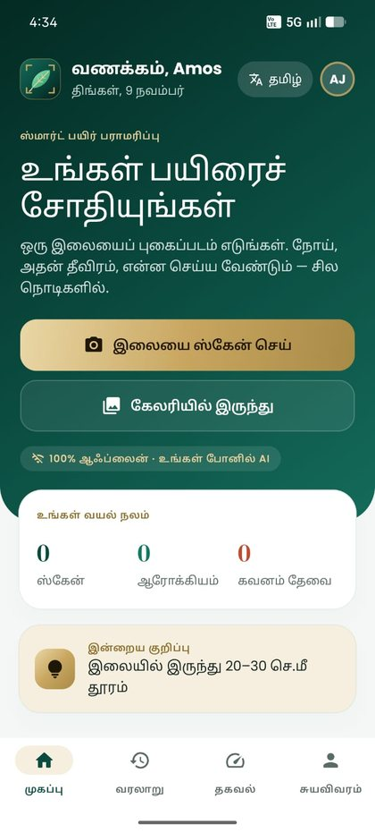<br/><sub>Home · Tamil</sub></td>
<td align="center">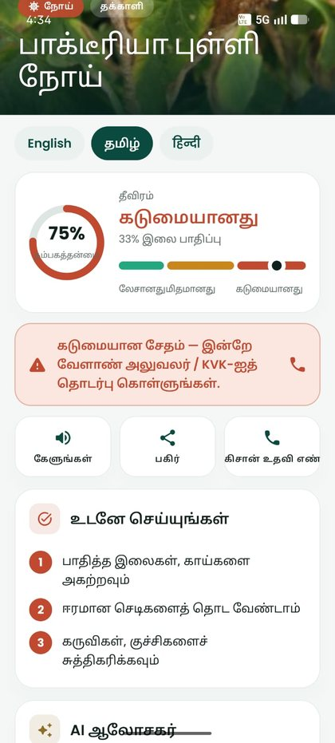<br/><sub>Diagnosis · Tamil</sub></td>
<td align="center">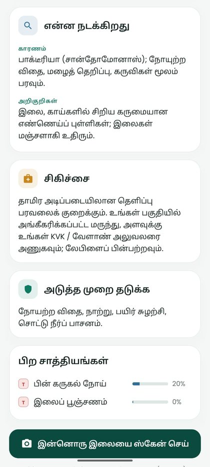<br/><sub>Guidance · Tamil</sub></td>
<td align="center">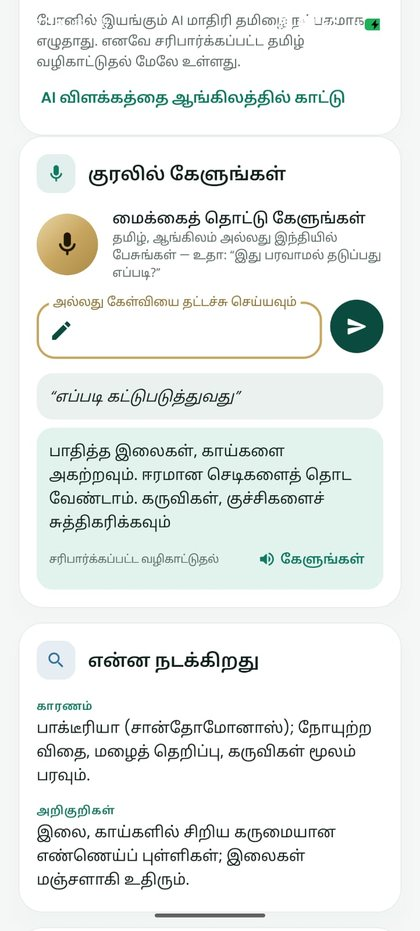<br/><sub>Question in Tamil</sub></td>
</tr>
<tr>
<td align="center">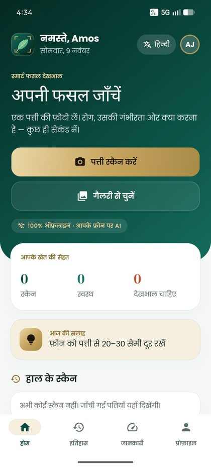<br/><sub>Home · Hindi</sub></td>
<td align="center">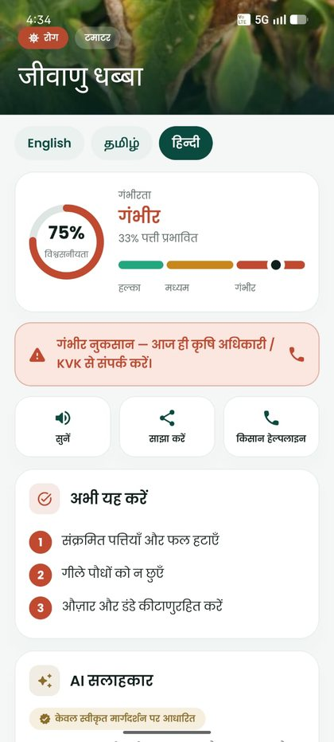<br/><sub>Diagnosis · Hindi</sub></td>
<td align="center">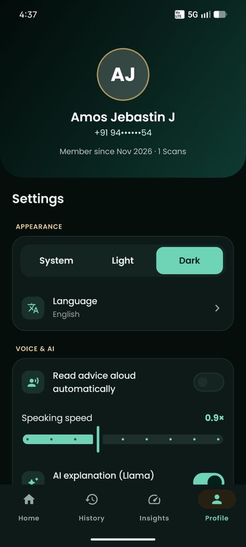<br/><sub>Profile & settings</sub></td>
<td></td>
</tr>
</table>
</details>

## How to use

1. **Choose your language** — English, தமிழ் or हिन्दी (changeable any time).
2. **Sign in** with your mobile number; first time, add your name, village and a password (a 4-digit PIN is fine).
3. Tap **Scan a leaf** and fit **one leaf inside the gold frame**, in daylight, 20–30 cm away — or **Upload from gallery**.
4. In about a second you get the **disease, crop, confidence and severity**, then:
   **Do this now** → **AI advisor** → **Ask by voice** → **What is happening · Treatment · Prevention**.
   Tap **Listen** to hear it, **Share** to send it on WhatsApp, or **Call Kisan helpline** (1800-180-1551).
5. If the photo is unclear or the crop is not supported, the app says **"We are not sure"** and shows photo tips — it never guesses.
6. **History** keeps every scan; **Insights** shows speed and accuracy measured on the phone; **Profile** has language,
   dark mode, voice speed and password.

## Architecture

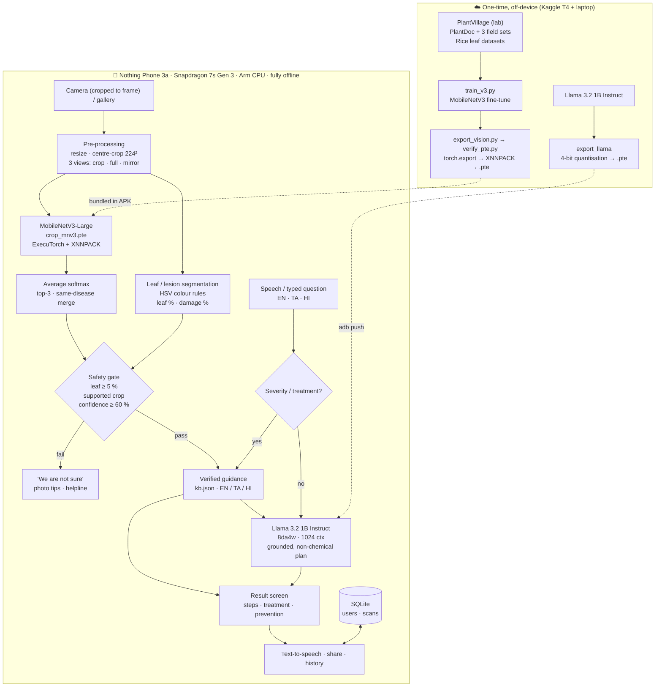

**Design choices**

- **Two models, two jobs.** A 5 M-parameter CNN does the diagnosis (fast, measurable); the 1 B-parameter LLM only
  *explains* a care plan that already exists in a vetted knowledge base. Llama never sees chemical treatments — those are
  shown word-for-word from the verified guidance — so it cannot invent a product or a dose.
- **Language-aware AI.** Llama writes English and Hindi (languages Llama 3.2 supports) from the verified plan *in that
  language*. For Tamil the app shows verified Tamil guidance and answers Tamil questions from it, with an optional AI
  explanation in English.
- **Test-time augmentation.** Each photo is classified three times (centre crop, whole frame, mirror) and the
  probabilities averaged — steadier on real, cluttered field photos.
- **Fail safe, not confident.** Below 60 % confidence, or with too little leaf in the photo, the app refuses to diagnose.

**Engineering problems solved on the device**

| Problem | Root cause | Fix |
|---|---|---|
| Random crashes / endless scans | Creating an ExecuTorch `LlmModule` resets the process-wide XNNPACK thread-pool; the vision model kept a pointer to the destroyed pool | Fixed start-up order: create both models → load Llama → only then run the vision model; all inference serialised, scans pre-empt the LLM |
| AI advice failed after a few answers | The LLM runner kept one growing conversation until the 1024-token context was full | `resetContext()` before every answer; answers length-capped |
| LLM refused or rambled | Llama 3.2's safety tuning reacts to pesticide text; small models drift | Non-chemical plan only, farmer's-voice prompt, pre-started "1." answer, refusal detection, end-of-turn stop |
| Inflated field accuracy | 83 test photos re-appeared in new field datasets | Perceptual-hash de-duplication; results reported only on unseen photos |

## Results

All accuracy numbers use **real farm photos** (PlantDoc test split), measured **on the phone** through the app's own
pipeline (*Insights → Run field-photo test*).

| Metric | v2 | **v3 · final model** |
|---|---|---|
| Disease correct — tomato, potato, pepper | 58.6 % (75 / 128) | **59.6 %** (28 / 47, clean set) |
| Crop correct | 89.0 % | **93.5 %** |
| Correct when the app is sure (≥ 60 %) | 87.4 % | **93.1 %** — on 85.6 % of photos |
| All field photos, incl. "other crop" | 77.1 % (236 photos) | **88.5 %** (148 clean photos) |
| Lab photos (PlantVillage test split) | 98.9 % | 98.7 % (6 411 photos) |

**When the app is sure it is right 93 % of the time; otherwise it says "not sure" instead of guessing** — the behaviour
that matters most for a farmer.

**On-device performance** (Nothing Phone 3a, Snapdragon 7s Gen 3, Arm CPU via XNNPACK)

| | |
|---|---|
| Vision inference (3 views + pre-processing) | **29 ms** average over 153 photos · 41 ms single scan |
| Llama 3.2 1B generation | **≈ 15 tokens/s** · first word in ≈ 1.0–1.2 s |
| Llama memory after load | ≈ 1.1 GB RSS |
| Model sizes | vision 17 MB (in the APK) · Llama 0.8 GB (4-bit) |

The phone's v2 field accuracy (58.6 %) matches the PyTorch result on Kaggle (59.4 %) to within one photo, and every new
vision model is checked against PyTorch before installing (`training/verify_pte.py`), so the ExecuTorch / XNNPACK export
costs no accuracy.

**Evaluation integrity.** v3 adds three public field datasets. A perceptual-hash check found that **83 of the 236
PlantDoc test photos also appear (resized or re-saved) inside those datasets**, which would have inflated v3's score to
77.8 %. Those photos are excluded everywhere (`docs/leaked_test_photos.txt`). The clean set has no maize photos left, so
maize is evaluated only in the v2 column.

<details>
<summary><b>Per-class field accuracy (v2, on phone, 236 photos)</b></summary>

| Class | Correct |
|---|---|
| Tomato — Septoria leaf spot | 100 % (11/11) |
| Maize — Common rust | 90 % (9/10) |
| Pepper — Healthy | 87.5 % (7/8) |
| Tomato — Yellow leaf curl virus | 83.3 % (5/6) |
| Tomato — Late blight | 70 % (7/10) |
| Tomato — Healthy | 62.5 % (5/8) |
| Pepper — Bacterial spot | 55.6 % (5/9) |
| Tomato — Leaf mold | 50 % (3/6) |
| Tomato — Mosaic virus | 50 % (5/10) |
| Tomato — Early blight | 44.4 % (4/9) |
| Maize — Northern leaf blight | 41.7 % (5/12) |
| Potato — Early blight | 37.5 % (3/8) |
| Potato — Late blight | 37.5 % (3/8) |
| Maize — Grey leaf spot | 25 % (1/4) |
| Tomato — Bacterial spot | 22.2 % (2/9) |

Per-photo results: [`docs/eval_results_v2.csv`](docs/eval_results_v2.csv), [`docs/eval_results_v3.csv`](docs/eval_results_v3.csv)
</details>

## Tech stack

| Layer | Technology |
|---|---|
| App | Kotlin, Jetpack Compose (Material 3), CameraX, Android TextToSpeech & speech recogniser |
| On-device inference | PyTorch **ExecuTorch**, **XNNPACK** delegate (Arm NEON), `LlmModule` runner |
| Vision model | MobileNetV3-Large, ImageNet → PlantVillage + PlantDoc + field + rice datasets, FP32 |
| Language model | Llama 3.2 1B Instruct, 8-bit dynamic activations / 4-bit weights, KV-cache + SDPA, 1024-token context |
| Storage | SQLite (app-private), PBKDF2-HMAC-SHA256 salted passwords |
| Training | PyTorch + torchvision on Kaggle (NVIDIA T4), mixed precision, weighted field sampling |

## Repository structure

```
├── app/src/main/java/com/cropadvisor/
│   ├── Vision.kt          MobileNetV3 inference, 3-view TTA, leaf & lesion segmentation, runtime lock
│   ├── Advisor.kt         Llama 3.2 1B loading, grounded prompts, streaming, voice-question topics
│   ├── AppState.kt        app logic: start-up order, scans, advice, voice Q&A, accounts, benchmarks, field test
│   ├── Db.kt              on-device SQLite database (users, scans) + password hashing
│   ├── Strings.kt         all UI text in English, Tamil, Hindi
│   └── ui/                Compose screens, jade & champagne theme, logo & animations
├── app/src/main/assets/   kb.json (verified guidance, 3 languages) · labels.json
├── training/
│   ├── train_v2.py        Kaggle training (lab + field photos)
│   ├── train_v3.py        + 3 extra field datasets, 20 epochs (final model)
│   ├── export_vision.py   PyTorch → ExecuTorch .pte (XNNPACK)
│   ├── verify_pte.py      checks the .pte against PyTorch before it is installed
│   └── prepare_eval.py    copies clean PlantDoc test photos to the phone for the on-device test
├── docs/                  screenshots, logo, results, leaked-photo list
└── uzhavan.sh             one command: convert + verify vision model, export & push Llama, build, install, launch
```

## Build & run

**Requirements:** Ubuntu laptop with Android SDK + JDK 17, an ExecuTorch source checkout (`~/executorch`) with its Python
env (`~/et-env`), the Llama 3.2 1B Instruct checkpoint, and an Arm64 Android phone with USB debugging on.

```bash
# 1. vision model: train on Kaggle (training/train_v3.py), put crop_mnv3_v3.pth + labels.json into ~/crop
# 2. one command: converts + verifies the vision model, exports Llama (first time), pushes it, builds, installs, opens
bash ~/CropAdvisor/uzhavan.sh

# 3. optional: on-device accuracy test (then Insights → Run field-photo test)
python3 ~/CropAdvisor/training/prepare_eval.py
```

Model files (`*.pte`, `*.pth`) are not stored in git; the scripts above produce them.
For voice input without internet, install the offline speech packs (Gboard → Voice typing → Offline speech recognition).

## Safety & privacy

- Advice comes only from the verified knowledge base (`kb.json`). The LLM explains the non-chemical care plan;
  treatments and doses are shown word-for-word and always point to the local KVK / agriculture officer.
- Low confidence, unsupported crops or photos without a leaf never receive treatment advice.
- If Llama ever crashes it is switched off automatically and the verified guidance is still shown.
- Photos, history and accounts stay on the phone: the app has **no INTERNET permission** and Android cloud backup is off.
- Passwords are salted and hashed (PBKDF2); 5 wrong attempts lock the account for 30 s.

## Limitations & next steps

- Real-field accuracy (~60 % per disease) is far below lab accuracy (99 %): field photos have clutter, shadows and mixed
  symptoms, and public field datasets are small (few test photos per class, so per-class numbers are rough).
- Pests outside the training classes (e.g. leaf miner) get "not sure" rather than a guess.
- Severity is a colour heuristic, not a trained segmentation model.
- Next: Indian field photos collected with KVKs, INT8 vision model, NPU delegate (Qualcomm QNN) for lower power,
  an Indic LLM for native Tamil explanations.

## Acknowledgements

[PlantVillage](https://github.com/spMohanty/PlantVillage-Dataset) · [PlantDoc](https://github.com/pratikkayal/PlantDoc-Dataset) ·
[PyTorch ExecuTorch](https://github.com/pytorch/executorch) · [Meta Llama 3.2](https://www.llama.com/) ·
Poppins & DM Serif Display fonts (SIL OFL) · Kisan Call Centre 1800-180-1551

## License

Code: [MIT](LICENSE). **Built with Llama** — Llama 3.2 is used under the Llama 3.2 Community License. Third-party components and datasets keep their own licenses: see [THIRD_PARTY_NOTICES.md](THIRD_PARTY_NOTICES.md).
